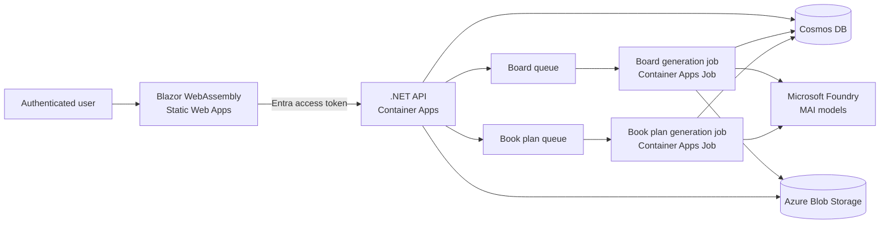

<div align="center">

# MAI Comic Studio

Generate illustrated comic boards and long-form books with Microsoft Foundry and MAI models on Azure.

[](https://dotnet.microsoft.com/)
[](https://learn.microsoft.com/azure/developer/azure-developer-cli/)
[](https://learn.microsoft.com/azure/azure-resource-manager/bicep/)
[](LICENSE)

[Architecture](docs/architecture.md) · [Requirements](docs/requirements.md) · [Deploy with azd](docs/deployment.md)

</div>

## What it does

MAI Comic Studio provides authenticated Blazor workspaces for comic boards and books. Comic generation uses a queued background job. Book projects retain their source idea and editable chapter plan, then use explicit, independently retryable API stages to write each chapter with `MAI-Thinking-1` and generate one illustration with `MAI-Image-2.5-Pro`.

- Create and reorder up to eight comic panels.
- Keep character identity consistent with private reference images.
- Track asynchronous generation progress per panel.
- Download individual panels and the composed board.
- Scaffold, edit, resume, and selectively regenerate illustrated book chapters.
- Deploy the application and its Azure dependencies with `azd` and Bicep.
- Use managed identities and RBAC instead of application secrets.

## Architecture



See [the architecture guide](docs/architecture.md) for resource, security, and sequence diagrams.

## Quick start

Install the tools and confirm the Azure permissions listed in [requirements](docs/requirements.md), then run:

```powershell
azd auth login
az login

azd env new
azd env set AZURE_LOCATION swedencentral
$principalId = az ad signed-in-user show --query id --output tsv
azd env set DEPLOYER_PRINCIPAL_ID $principalId

azd up
```

`azd up` provisions the infrastructure, builds the two containers, injects the generated Entra configuration into the frontend, and deploys all three application services. Model availability and quota are subscription and region dependent; verify them before provisioning.

For redeployment behavior, validation, outputs, and teardown, follow [Deploy with azd](docs/deployment.md).

## Repository layout

| Path | Purpose |
| --- | --- |
| `src/MaiImageGenerator.Web` | Blazor WebAssembly comic authoring experience |
| `src/MaiImageGenerator.Api` | Authenticated API, persistence, uploads, and job submission |
| `src/MaiImageGenerator.Jobs.BoardGeneration` | Queue-driven panel and board generation worker |
| `src/MaiImageGenerator.Shared` | Shared configuration, data entities, and queue contracts |
| `src/MaiImageGenerator.Console` | API-key console for testing MAI image models and resolutions |
| `infra` | Bicep entry point and reusable Azure resource modules |
| `scripts` | `azd` lifecycle and frontend packaging scripts |
| `docs` | Architecture, requirements, and deployment documentation |

## Development

```powershell
dotnet restore .\src\MaiImageGenerator.slnx
dotnet build .\src\MaiImageGenerator.slnx
```

To call a deployed MAI image model directly with an API key and compare output resolutions, see the [MAI image console](src/MaiImageGenerator.Console/README.md).

Checked-in configuration contains only local placeholders. Azure values are supplied as environment variables by Bicep and `azd`; do not commit connection strings, tokens, tenant-specific endpoints, or generated `.azure` state.

## Project status

This repository is a reference implementation for testing, learning, and evaluation. Review identity, network, content safety, quotas, resilience, and cost controls before adapting it for production use.

## Contributing

Keep changes scoped to the owning component, update the relevant page in `docs/`, and validate the .NET solution plus the active Bicep graph before opening a pull request.

## License

Licensed under the [MIT License](LICENSE).