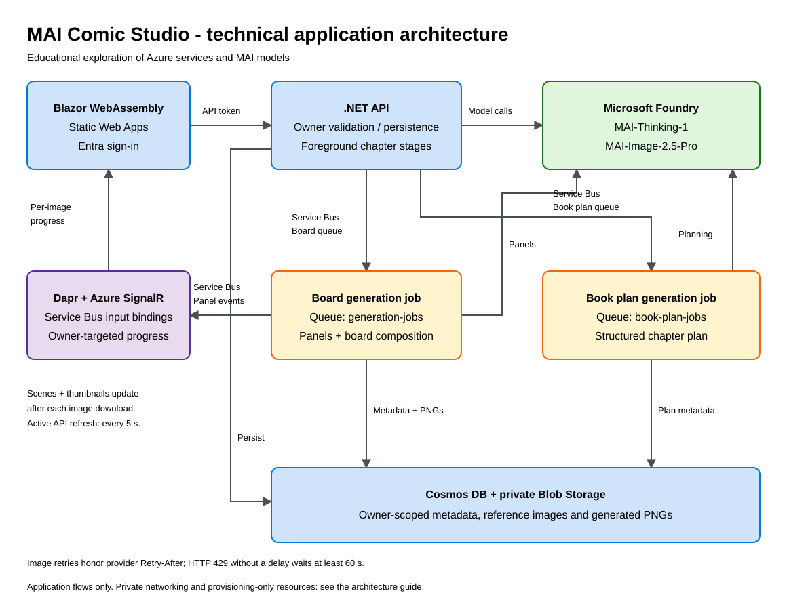

# MAI Comic Studio

An educational application for discovering Azure services, Microsoft Foundry, and MAI text and image models by creating comic boards and illustrated books.

[](https://dotnet.microsoft.com/)
[](https://learn.microsoft.com/azure/developer/azure-developer-cli/)
[](https://learn.microsoft.com/azure/azure-resource-manager/bicep/)
[](LICENSE)

<div align="center">

[**SOLUTION OVERVIEW**](#solution-overview) | [**QUICK DEPLOY**](#quick-deploy) | [**BUSINESS SCENARIO**](#business-scenario) | [**SUPPORTING DOCUMENTATION**](#supporting-documentation)

</div>

> **Educational use only:** This repository exists solely to support training, experimentation, and discovery of Azure services and MAI models. It is not a production solution, a commercial offering, or an officially supported Microsoft product. Deployment creates billable resources. See [Disclaimers](#disclaimers).

## Solution overview

MAI Comic Studio turns a story idea into editable comic scenes or a chapter plan. Users sign in with Microsoft Entra ID, refine their content, generate images, and reopen saved projects in a Blazor WebAssembly workshop.

The application uses `MAI-Thinking-1` for story scaffolding, prompt rewriting, book planning, and prose, and `MAI-Image-2.5-Pro` for illustrations. Cosmos DB stores owner-scoped metadata; private Blob Storage holds reference images and generated PNGs.

### Solution architecture



[Technical architecture and sequence diagrams](docs/architecture.md) | [Functional workflow](docs/functional-guide.md#functional-overview) | [Editable Excalidraw source](docs/images/solution-architecture.excalidraw)

Board generation and book planning run in separate queue-driven Container Apps Jobs. Chapter prose and chapter illustrations run as explicit API requests, not background jobs. The diagram is an application-flow overview; networking, provisioning-only resources, and trust boundaries are detailed in the architecture guide.

### Additional resources

- [Microsoft Foundry](https://learn.microsoft.com/azure/ai-foundry/)
- [Microsoft Agent Framework](https://learn.microsoft.com/agent-framework/)
- [Azure Container Apps](https://learn.microsoft.com/azure/container-apps/)
- [Azure Cosmos DB](https://learn.microsoft.com/azure/cosmos-db/)

## Features

### Key features

<details open>
<summary>Explore the learning scenarios and implemented capabilities</summary>

- **Story workshop:** create a comic or book through a guided wizard, then reopen it from a private project library.
- **Comic authoring:** edit and reorder scenes, select a layout, and reuse project characters with PNG/JPEG reference images.
- **Asynchronous boards:** generate panels in a background job, see each scene and thumbnail as its image arrives, inspect effective prompts, and download panels and composed boards. Owner-targeted SignalR updates are backed by active-generation status polling.
- **Illustrated books:** generate an editable plan of 1 to 30 chapters, write prose with prior-chapter context, and generate one illustration per chapter.
- **Selective retries:** retry book stages independently and preserve saved work; board workers reuse available completed panels on queue redelivery.
- **Azure integration:** explore managed identities, RBAC, private endpoints, Service Bus, Dapr, SignalR, telemetry, and Bicep.

</details>

See the [functional guide](docs/functional-guide.md) for user journeys, limits, failure handling, and processing flows.

## Getting Started

### Quick deploy

#### How to install or deploy

Read [requirements and costs](docs/requirements.md) first. Verify model access and regional quota, deployment permissions, and either permission to manage Entra applications or a [preconfigured authentication application](docs/deployment.md#choose-authentication-application-management).

From the repository root:

```powershell
azd auth login
az login
azd env new
azd env set AZURE_LOCATION swedencentral
$principalId = az ad signed-in-user show --query id --output tsv
azd env set DEPLOYER_PRINCIPAL_ID $principalId
azd up
```

The deployment provisions Azure dependencies, remotely builds three backend containers, and packages and deploys the Blazor frontend: four application services in total. Open `SERVICE_WEB_URI` from the deployment outputs and sign in.

Follow [the deployment guide](docs/deployment.md) for verification, redeployment, troubleshooting, and resource removal. Model availability is not guaranteed by the template.

## Guidance

### Prerequisites and costs

You need .NET 10, PowerShell 7, Azure CLI, Azure Developer CLI, Git, and appropriate Azure/Entra permissions. Docker is useful for local container checks. The default primary region is Sweden Central; Static Web Apps is provisioned in West Europe.

Foundry model capacity, AI Search Standard, SignalR Standard, Container Registry Premium, Cosmos DB, networking, monitoring, and storage can incur charges even when nobody is generating content. No fixed cost estimate or free-tier-only deployment is promised. Set a budget and remove training environments when finished.

See [requirements](docs/requirements.md) for model versions, capacities, tooling, and readiness checks.

## Resources

### Business scenario

#### Learning value

<details open>
<summary>Use a creative scenario to understand Azure application patterns</summary>

- **Training workshops:** trace a story from browser input to model invocation, persistence, and authenticated download.
- **Multimodal discovery:** compare text-to-image prompts with reference-guided comic panels and understand model limitations.
- **Workflow exploration:** contrast durable queued generation with foreground API operations and explicit user review.
- **Cloud engineering practice:** inspect identity boundaries, owner partitioning, deployment hooks, and operational diagnostics.

</details>

These are educational scenarios, not claims of business suitability or production readiness.

### Supporting documentation

#### Functional guide

[User journeys and functional flows](docs/functional-guide.md): creating projects, generating boards and chapter images, saving, resuming, and handling failures.

#### Technical guide

[Architecture](docs/architecture.md): components, Azure topology, sequence diagrams, data ownership, queue contracts, API surfaces, configuration, and development checks.

[Deployment](docs/deployment.md): the supported `azd` lifecycle. [Documentation index](docs/README.md): all guides, including the UX design proposal.

#### Security guidelines

The reference deployment uses Entra authentication, a user-assigned managed identity, RBAC, owner-partitioned Cosmos queries, and private endpoints for backend data and model services. The frontend, authenticated API, and SignalR service have public entry points. AI Search and the Foundry capability host are provisioned but are not used for retrieval or hosted-agent orchestration in the current generation flows.

Use synthetic, non-sensitive inputs; do not upload personal data, secrets, or content you lack permission to use. Private networking is not a complete production security posture. Review the [documented boundaries and limitations](docs/architecture.md) and [responsible AI guidance](docs/responsible-ai.md). Enable repository secret scanning where available.

#### Cross references

- [Content generation solution accelerator](https://github.com/microsoft/content-generation-solution-accelerator): related multimodal learning material and the structural reference for this README.
- [Microsoft AI playbook](https://learn.microsoft.com/ai/playbook/): engineering guidance for AI applications.

## Provide feedback

Report reproducible problems or documentation gaps through [GitHub issues](https://github.com/mathieumack/foundry-comics-mai/issues). Do not include tokens, generated Azure environment values, private images, or tenant-specific endpoints. Feedback does not imply a support commitment or service-level agreement.

For contributions, respect component ownership, update the relevant documentation, and follow the [development checks](docs/architecture.md#development-and-validation).

## Responsible AI Transparency FAQ

See the [Responsible AI and transparency FAQ](docs/responsible-ai.md) for intended use, model limitations, human review, data handling, and content-safety caveats.

## Disclaimers

This repository has no intended purpose beyond training and discovery of Azure services and MAI models. It is provided for educational experimentation only, not for production deployment, commercial service delivery, or consequential decisions. No fitness for any real-world use is asserted.

AI-generated text and images can be inaccurate, biased, inconsistent, offensive, or infringe third-party rights. Review all outputs and use only inputs you are authorized to process. You are responsible for applicable laws, service terms, privacy, safety, usage charges, and resource cleanup.

This is an independent community project. References to Microsoft, Azure, Foundry, or MAI do not imply Microsoft authorship of the project, affiliation, endorsement, certification, or support. Existing third-party copyright notices must be retained.

### License and copyright

Copyright (c) 2026 MACK Mathieu. The repository is licensed under the [MIT License](LICENSE), including its warranty and liability disclaimer. The educational-purpose statement describes the project's intent; it does not add a use restriction to, or override, the permissions granted by MIT.

Third-party code, packages, services, model terms, and trademarks remain subject to their respective licenses and terms. The repository license does not grant rights to uploaded references, generated content, or third-party brands beyond any rights their respective terms provide.
