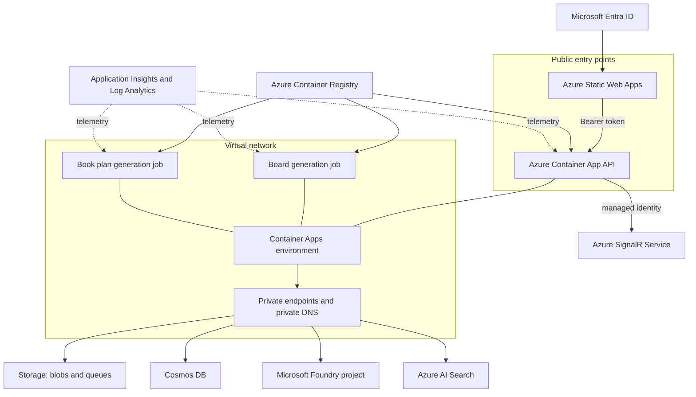
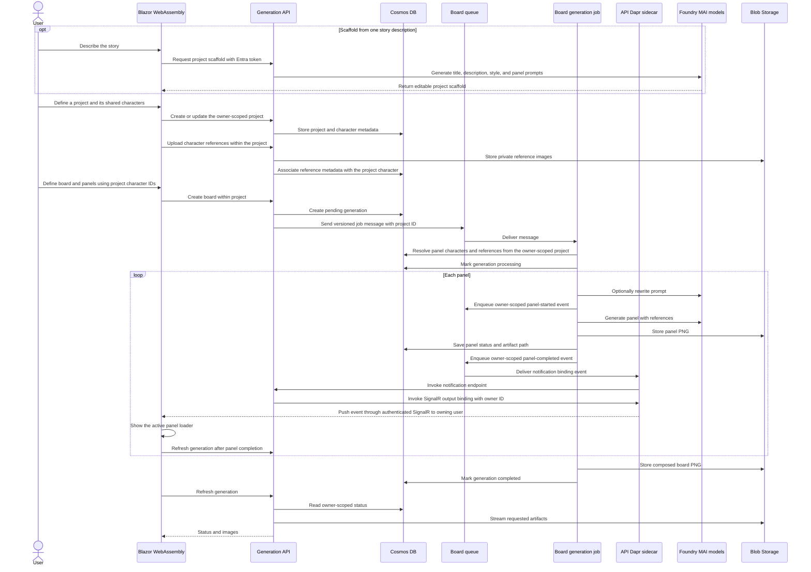
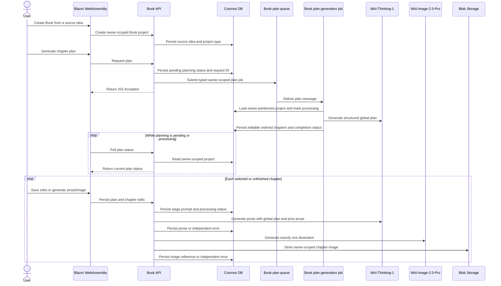

# Architecture

## Application components

| Component | Responsibility |
| --- | --- |
| Blazor WebAssembly | Authenticates users with Microsoft Entra ID, lists comic and book projects, captures or scaffolds editable board, plan, chapter, and character inputs, uploads references, and displays generation progress. |
| .NET API | Enforces user ownership, uses MAI-Thinking to scaffold stories and write book chapters, validates requests, stores metadata, generates chapter illustrations, submits generation queue messages, and streams generated artifacts. |
| Board generation job | Consumes only the board-generation queue, rewrites prompts, generates panels, composes the board, and updates durable status. |
| Book plan generation job | Consumes only the book-plan queue, generates the structured chapter plan, and updates durable status. |
| Shared library | Defines Cosmos entities, configuration types, database context, and the versioned queue message contract. |

## Azure topology

The Container Apps environment has external ingress for the API and VNet integration for private service access. Storage, Cosmos DB, AI Search, and Foundry use private endpoints. Azure SignalR Service runs in Default mode so the API hosts the server-push-only notification hub while the service handles client connection scale-out. Negotiation requires the authenticated user's identifier claim and binds that identifier to the connection. Static Web Apps, the authenticated API, and SignalR remain public entry points. Container Registry is public in the reference deployment and also has a private endpoint.

## Generation sequence

The worker processes one message per execution. It requests regular slots at 1024 × 1024 and full-row slots at 1365 × 768, the widest 16:9-like dimensions within MAI's 1,048,576-pixel limit. It uses the MAI-native integer `width` and `height` parameters for text-to-image generation and the multipart `size` parameter for reference-guided image edits. The composer crops without distortion to the exact board slot. Technical failures are retried and removed after the configured maximum dequeue count. An image content-safety rejection is recorded on the affected panel instead: the worker continues with later panels, leaves a placeholder in the composed board, and completes the job with panel-level error details available to the UI.

## Book generation

Books are first-class `ProjectDocument` values with `Type=Book`. The owner-partitioned project document retains the source idea, the plan-generation request ID, prompt and status, stable ordered chapter IDs, editable plan fields and prose, illustration prompts, one image reference per chapter, and separate prose/image status and errors. Plan generation is submitted to the dedicated `book-plan-jobs` queue and processed by its own Container Apps Job, so slow planning cannot consume board-generation executions. The API request returns immediately; the Web client polls the durable status and can safely be closed and reopened. The request ID makes delivery idempotent and prevents an older queued message from replacing a newer plan request. Each stage is saved before and after a model call. Reopening the project therefore restores completed work, while interrupted or failed planning, prose, and illustration calls can be retried independently without replacing unrelated chapters. Regeneration overwrites only the selected chapter artifact at its stable owner-scoped blob path.

The planning prompt requests string fields. If the model returns summaries, character events, or continuity notes as nested JSON objects or lists of text, the worker converts them to editable multiline text while retaining object labels and list order. Missing, empty, null, or non-text notes and incorrect chapter counts still fail validation and are logged by the worker; an invalid response never replaces the saved chapters.

The Web client explicitly coordinates unfinished chapters rather than giving an autonomous agent control over persistence. Every prose request receives the complete current plan plus generated prior-chapter prose, so the writing agent can preserve plot and character continuity. This deterministic API orchestration also keeps user edits as the source of truth between stages.

### Agent Framework harness evaluation

The [Agent Framework harness](https://learn.microsoft.com/en-us/agent-framework/concepts/harness) adds autonomous planning, tools, memory, loops, and approvals to a chat agent, but it is not a durable workflow engine and does not provide an image-generation abstraction. Its basic chat loop can use the project's OpenAI-compatible `MAI-Thinking-1` client, but harness-specific hosted tools are not established as compatible with that model, and `MAI-Image-2.5-Pro` still requires the existing image client.

Agent Framework [workflows and checkpoints](https://learn.microsoft.com/en-us/agent-framework/workflows/checkpoints) are the better fit for a future multi-worker pipeline. Automatic process-loss recovery additionally requires the preview Durable Task integration and new hosting dependencies. The current implementation instead uses separate, explicit plan, prose, and image API operations with Cosmos checkpoints. This provides deterministic prompts, independent retries, and edit preservation without adding a preview orchestration dependency. If generation later moves fully to background workers, these operations can become idempotent workflow activities keyed by project, chapter, and stage.

The job writes panel-started and panel-completed contracts to dedicated owner-scoped notification queues. Azure Container Apps Jobs do not host managed Dapr sidecars, so the API's Dapr sidecar consumes those queues through managed-identity Storage Queue input bindings. The API invokes Dapr's Azure SignalR output binding with the owner ID in the `user` metadata field; the binding sends directly to that SignalR user on the ASP.NET-derived `notificationhub` hub without broadcasting or using groups. The Web client negotiates the notification hub with its API-scoped Entra access token, shows the loader for the panel named by each start event, and refreshes the active board after each completion event. Because the worker and API use independent Cosmos DB sessions, the Web client performs a short bounded retry after a completion event until the panel artifact or terminal error is visible.

The projects API creates, lists, retrieves, and updates projects through owner-partition-scoped queries. Character CRUD and reference uploads are nested under a project. Comic projects accept boards whose panel character IDs resolve within that project; Book projects reject board creation and expose their plan and chapters instead. Each board generation persists its selected layout template (Standard, Storyline, Dynamic 1, or Dynamic 2), and the worker uses that template's ordered row, column, and span slots when composing the final artifact. The Web project landing page routes each project type to its dedicated workspace.

## Data ownership

The `core` Cosmos database contains the `projects`, `documents`, and `references` containers. All three use `/ownerId` as their partition key. Projects own the shared character library and, for Book projects, the book plan and chapters. Generation documents in `documents` identify their parent comic project with `ProjectId` and panels reference project characters by ID. Controllers derive the owner from the authenticated principal instead of accepting it from request payloads. Comic and chapter-image blob paths include a one-way owner prefix and generation or book identifier. Preserve these boundaries whenever adding queries, endpoints, or background messages.

The queue contract contains a schema version. Make backward compatibility explicit before changing it because deployed API and worker revisions may overlap.

## Identity and secrets

- The browser obtains an Entra access token for the generated API scope.
- Container Apps authentication validates the API audience.
- The API and worker use a user-assigned managed identity through `DefaultAzureCredential`.
- The API authenticates to Azure SignalR Service with that identity. The SignalR App Server role supports the ASP.NET hub connection, and SignalR REST API Owner supports user-targeted sends from the Dapr output binding; no SignalR access key is injected.
- Azure service access is granted with RBAC; application code does not require storage keys, database keys, or model API keys.
- Application Insights receives its connection string from the deployment environment, not source-controlled appsettings.

## Foundry models

| Deployment | Version | SKU | Capacity |
| --- | --- | --- | ---: |
| `MAI-Thinking-1` | `2026-06-01` | `GlobalStandard` | 500 |
| `MAI-Image-2.5-Pro` | `2026-06-19` | `GlobalStandard` | 2 |

The deployments use automatic default-version upgrades and the `GuardrailNoLimits` RAI policy. Treat these as reference settings: review content safety requirements and confirm regional model availability and quota before every new environment.

## Infrastructure ownership

The authoritative deployment graph is `infra/main.bicep`; `azure.yaml` owns service packaging and lifecycle hooks. Avoid creating resources manually when they belong in the graph. Update this document whenever a component, data flow, trust boundary, or Azure dependency changes.