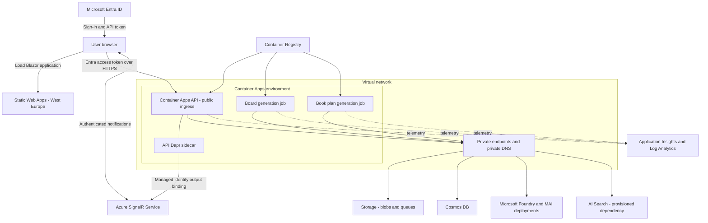
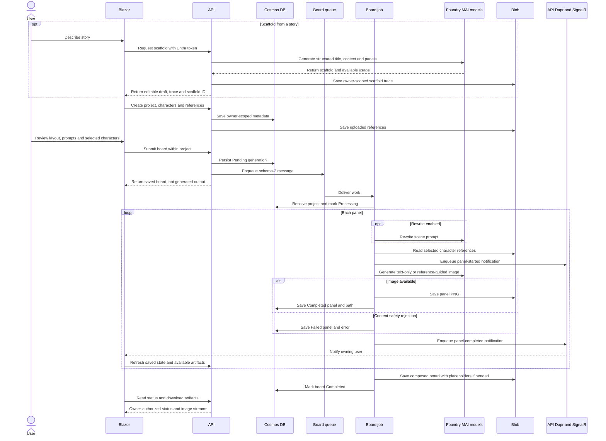
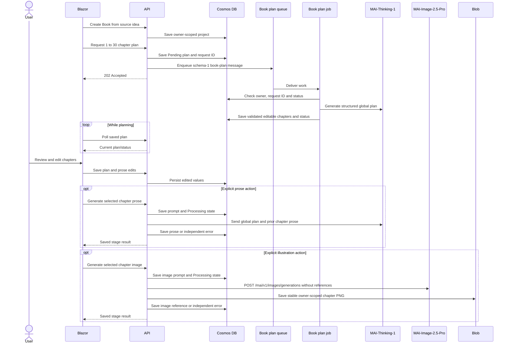

# Architecture

This page describes the implemented educational application, not a production reference architecture. See the [functional guide](functional-guide.md) for user journeys and functional flows, and the [transparency FAQ](responsible-ai.md) for intended use, AI limitations, and licensing.

## Application components

| Component | Responsibility |
| --- | --- |
| Blazor WebAssembly | UI, MSAL authentication, owner-scoped project library, story wizard, comic/chapter editors, reference uploads, progress display, and API client. |
| .NET API | Authenticated HTTP boundary, ownership checks, validation, persistence, reference/artifact streaming, queue submission, comic scaffolding, and foreground chapter prose/images. |
| Board generation job | Consumes the board queue, optionally rewrites prompts, generates panels, composes boards, persists status, and emits progress notifications. |
| Book plan generation job | Consumes the book-plan queue, generates and validates structured plans, and persists editable chapters and status. |
| Shared library | Cross-process data/configuration types, Cosmos context, and versioned messages. |

The deployment packages four services: `web`, `api`, `generationjob`, and `bookplanjob`. Only board generation and book planning are queued. Azure AI Search and Foundry project/capability-host resources are provisioned, but current generation services do not perform search-grounded retrieval or use hosted-agent orchestration.

GitHub Actions deploys the same `azd` resource graph using a federated deployment identity, separate from the application's runtime identity. Branch-scoped OIDC credentials authenticate both azd and Azure CLI; environment-variable mappings in `infra/main.parameters.json` support pipeline configuration while `infra/main.bicepparam` remains the provisioning parameter source. Runs targeting the same environment are serialized. See [deployment](deployment.md#configure-github-actions) for setup and permission boundaries.

Authentication application management is conditional: without `EXISTING_ENTRA_CLIENT_ID`, two Microsoft Graph modules create/update the application and service principal, then configure the deployed SPA redirects. With an existing client ID, both modules are skipped without querying Graph; an administrator owns the application, scope/consent, and redirect configuration outside CD. The API and frontend use the same resolved client ID and `access_as_user` scope in either mode. An optional `EXISTING_ENTRA_API_AUDIENCE` overrides the conventional API identifier URI only in reuse mode. This separates Azure deployment/RBAC rights from Graph application-management rights without changing runtime authentication.


The [editable Excalidraw source](images/solution-architecture.excalidraw) accompanies this overview. It intentionally omits provisioning-only dependencies and detailed network boundaries.

## Frontend workshop

The authenticated root route and `/projects` show the creative workshop/library. Each comic or book can be permanently deleted there after explicit confirmation. `/new` is a three-step story wizard that creates a real owner-scoped project. Comic scaffolding is prepared before project creation and passed to the editor through a scoped, in-memory draft store; it is not a persisted board until generation is submitted. Book creation submits a durable plan job. A failed plan submission can be retried without creating another project.

The comic workspace retains project and board routes, displays one selected scene beside a template-aware preview, and manages shared characters/references through project endpoints. Generated versions, per-panel SignalR progress, bounded status refresh retries, partial failures, effective prompt inspection, and PNG downloads remain available. `/boards/new` preserves free-form generation; legacy `/?generationId=...` links redirect there.

Books use a chapter navigator and active editor, explicit save, plan polling, browser-coordinated generate-missing, and independent prose/image states. Navigation guards warn about unsaved edits. Chapter writing and illustration require keeping the page open while API operations complete.

The shell uses CSS theme tokens and Radzen components. Light/dark mode defaults to browser preference; only the theme choice is stored locally. Library artwork identifies the format, not a generated cover. The [UX design](ux-design.md) and prototype record design rationale, not an additional deployment surface.

## Azure topology



The browser runs Blazor and calls the API directly; Static Web Apps is not an API proxy. In the comic editor, the scenes tab displays the selected panel image at large size beside a compact, clickable layout preview. The final board tab displays only the assembled board. Both panel and board images open in a full-screen viewer. Static Web Apps is deployed in West Europe, independently of the primary region. The Container Apps environment has external API ingress and VNet integration for private backend access. Storage, Cosmos DB, AI Search, and Foundry use private endpoints. Container Registry is public in the reference deployment and also has a private endpoint.

SignalR runs in Default mode: the API hosts the server-push-only hub while the service handles client connections. Negotiation binds the authenticated user's identifier to the connection. Static Web Apps, the authenticated API, and SignalR remain public entry points.

## Generation sequence



The worker requests regular panels at 1024 x 1024 and full-width slots at 1365 x 768, within MAI's 1,048,576-pixel limit. Composition crops without distortion to the selected board slots. A content-safety rejection leaves a failed panel and a placeholder but does not prevent later panels or board completion. Technical failures mark the generation failed and use queue redelivery instead.

### Image invocation paths

- **Comic panels:** the board job optionally rewrites context and scene text with an Agent Framework chat agent. It resolves current project characters and combines their reference images into a sheet. Text-only generation calls `/mai/v1/images/generations` with integer `width` and `height`; reference-guided generation uses the image-edit SDK operation against `/mai/v1` with multipart `size`. Image requests use the Cognitive Services token scope.
- **Chapter illustrations:** `BookService` uses the saved image prompt or constructs one from context, title, summary, and continuity. It passes no reference sheet to the API's `FoundryImageGenerator`, which calls `/mai/v1/images/generations` with integer `width` and `height` for a 1024 x 1024 image.
- **Text:** API/job chat agents use `/openai/v1/` with the `https://ai.azure.com/.default` token scope.

Both image paths save private artifacts in `generations`. Chapter regeneration overwrites a stable image path; a new comic board gets a new generation ID.

### Request traceability

Every model invocation records an `AiGenerationTrace`: provider, configured model/deployment, operation, safe request/correlation ID, UTC start/completion times, duration, outcome, and independently nullable input/output/total token counts. Image requests also record their requested count and dimensions. Prompt rewrites and images have separate records on each panel; book-plan, chapter-prose, and chapter-image requests retain their own lists. Retries append requests rather than combining usage. Composing a board is not a model invocation and does not invent an additional usage record.

Usage is `provider-reported` only when the response supplies counters. Missing counters remain null; totals are not inferred from partial data or summed across requests. The contract also supports explicitly `estimated` usage, but the application does not currently estimate tokens. Metadata capture failures emit operational telemetry without model payloads and do not fail otherwise successful content generation.

Chat SDK usage types can normalize absent fields to zero, so a per-request `ChatClient` decorator captures field presence from the response before agent-level normalization. It retains only allowlisted counters and correlation IDs, never the raw response. Its source is linked into the three backend projects to reuse their existing OpenAI dependency without adding that dependency to the shared entity library.

Generation/project documents use schema 3 with owned trace collections. Older documents load with empty collections; queue schemas remain unchanged because messages still reference owner-scoped documents, not trace payloads. API responses expose only the allowlisted trace fields. The browser keeps them while refreshing panel state and shows compact indicators for images, effective prompts, scaffolds, book plans, and prose. Details are disclosed on hover, keyboard focus, or touch activation; unknown usage is never shown as zero.

Scaffold usage is saved immediately as `<sha256-owner-prefix>/<scaffold-id-N>/scaffold-trace.json` in the private `generations` container. The API returns an opaque scaffold ID, not a client-editable usage claim. Saving the scaffold into a new project or board resolves its metadata under the authenticated owner and attaches the traces and sidecar ID in Cosmos. Project deletion includes these linked sidecar prefixes. Project and board identifiers remain independently generated, preserving creation/retry behavior. Only trace metadata is in the sidecar; draft text still travels through the browser until saved. Unclaimed scaffold sidecars have no automatic expiration and remain until the environment is removed. If sidecar persistence fails, the generated draft and in-memory trace are still returned without a scaffold ID.

Request history describes the model calls, not authorship of subsequent manual edits or a billing ledger. See [responsible AI](responsible-ai.md#what-generation-trace-and-usage-data-is-retained) for retention and privacy limits.

### Notification delivery

The board job writes owner-scoped contracts to `panel-generation-started` and `panel-generation-completed`. Container Apps Jobs do not host managed Dapr sidecars. The API's sidecar consumes those queues through managed-identity Storage Queue input bindings, calls the notification controller, and sends through the Azure SignalR output binding using the owner ID in `user` metadata.

Messages target the ASP.NET-derived `notificationhub` hub, not a broadcast/group. Web negotiates with its API-scoped Entra token and refreshes after completion events. Independent Cosmos sessions mean an event can precede visibility of the latest artifact/state; Web uses bounded retries. Events are hints, not the durable status record.

## Book generation



Books are `ProjectDocument` values with `Type=Book`. The embedded plan retains its request ID, prompt, status, stable ordered chapters, planning fields, prose, illustration prompt/reference, and independent prose/image states. Planning is durable and browser-polled; prose/images are foreground API operations coordinated explicitly by Web, including generate-missing. Keeping Cosmos checkpoints does not make those calls durable workflow activities.

The plan worker accepts textual notes and normalizes nested objects or lists of text into editable multiline fields, retaining labels/order. Empty, null, non-text notes and incorrect chapter counts fail validation; invalid responses do not replace saved chapters.

Recreating a plan preserves prior chapter IDs, prose, prompts, image references, and stage states by position up to the shorter plan length. It replaces planning fields and drops later positions from the current plan. It does not reconcile preserved prose/images with a semantically different plan.

### Orchestration boundary

Current services use Agent Framework agents for individual chat operations, not autonomous persistence or a durable multi-worker workflow. The [Agent Framework harness](https://learn.microsoft.com/agent-framework/concepts/harness) is not a durable workflow engine and does not replace the image client. [Workflows and checkpoints](https://learn.microsoft.com/agent-framework/workflows/checkpoints) would be a separate future design requiring compatibility, dependency, and hosting review. No such pipeline is deployed here.

## Data ownership

The `core` Cosmos database contains `projects`, `documents`, and `references`, all partitioned by `/ownerId`. Controllers derive ownership from authentication, not client-supplied owner IDs. Every lookup/query must preserve that boundary, including background messages and artifact access.

| Store or message | Contents and boundary |
| --- | --- |
| Cosmos `projects` | Project type, characters/references, source idea, embedded book plan/chapters, and per-request AI traces. |
| Cosmos `documents` | Generation, parent project ID, layout, prompts, panel states, board/panel blob names, and per-request AI traces. |
| Cosmos `references` | Uploaded-reference metadata. |
| Blob `references` | `<sha256-owner-prefix>/<reference-id>.<extension>`. |
| Blob `generations` | `<sha256-owner-prefix>/<generation-or-book-id-N>/panel-NN.png`, `board.png`, or `chapter-<chapter-id>.png`. |
| Board message, schema 2 | `BoardId`, `OwnerId`, `ProjectId`, `RewritePrompt`. |
| Book plan message, schema 1 | `JobType=book-plan`, `RequestId`, `OwnerId`, `ProjectId`, `ChapterCount`. |

The owner hash avoids embedding raw owner identifiers in blob paths; it is not authorization. Comic panels reference project character IDs; Book projects reject board creation. Layouts are persisted as Standard, Storyline, Dynamic 1, or Dynamic 2. Review queue-schema compatibility explicitly because deployed API/worker revisions can overlap.

### Permanent project deletion

`DELETE /api/projects/{projectId}` resolves the authenticated owner and never accepts an owner ID from the browser. The API first saves a deletion marker, cancels queued or failed generation state, and makes both workers ignore stale messages. If a board, plan, prose request, or image request is already processing, deletion returns `409`; the user can retry after that operation finishes.

Cleanup enumerates the project's book prefix, every comic-generation prefix, and each reference prefix not shared by another project owned by the same user. It deletes base blobs, snapshots, and every stored version. Missing blobs are successful no-ops. Any storage failure is logged, returned as retryable `503`, and prevents Cosmos deletion.

After storage succeeds, the API deletes generation documents, exclusive reference documents, and finally the root project document. Cosmos cannot transact across these containers, so root-last ordering preserves the deletion marker as a retry anchor after a partial database failure. A successful response therefore means that no attributable database record or blob remains. Blob soft delete is disabled by the deployment so deleted artifacts are not retained for recovery; account versioning remains enabled for normal overwrites, and deletion removes all versions explicitly.

### Queues, recovery, and status

| Queue | Producer | Consumer |
| --- | --- | --- |
| `generation-jobs` | API | Board job. |
| `book-plan-jobs` | API | Book-plan job. |
| `panel-generation-started` | Board job | API Dapr input binding. |
| `panel-generation-completed` | Board job | API Dapr input binding. |
| `generation-jobs-poison`, `book-plan-jobs-poison` | Provisioned only | No implemented worker dead-letter transfer. |

Each job receives one message with six-hour visibility. Bicep configures a six-hour replica timeout, no replica-level retries, 30-second polling, and at most one execution per job. The two jobs run independently. A failed message remains invisible until the visibility timeout expires; after the fifth dequeue the worker logs and deletes it. Neither worker currently transfers failed messages to the provisioned poison queues. Do not rely on those queues for recovery/audit.

Board redelivery skips completed or canceled boards and reuses completed panels with existing PNGs; missing PNGs are regenerated. Book planning skips completed plans and obsolete request IDs. Both workers stop when the project has a deletion marker. These safeguards do not guarantee exactly-once execution.

Generation states are `Pending`, `Processing`, `Completed`, `Failed`, and `Canceled`; panel states omit `Canceled`. There is no cancellation API. Chapter prose and image stages have separate states/errors. Foreground cancellation resets the affected stage to `Pending` when its handler runs; abrupt process loss can leave `Processing` requiring an explicit retry.

Cosmos persistence and enqueue are separate operations, not a transaction/outbox. Book-plan enqueue failure records `Failed`; board enqueue failure can leave a persisted `Pending` record. Diagnose stuck work using both durable metadata and queue/job telemetry.

## Identity and secrets

- Web obtains an Entra token for the generated API scope.
- Container Apps authentication validates API access and audience.
- API/jobs use a user-assigned managed identity; API uses `DefaultAzureCredential`.
- SignalR App Server supports API hub connections; SignalR REST API Owner supports Dapr user-targeted sends.
- Azure access uses RBAC, without storage/database/model access keys.
- Telemetry and deployment-specific client configuration come from environment outputs, not committed values.

These controls are not production certification. The API has permissive application CORS; Dapr callbacks are service integration endpoints, not user operations. There is no implemented per-user rate limiting, comprehensive moderation, or scheduled retention workflow. Review ingress/authentication, callback reachability, CORS, logging, and abuse controls before any independent adaptation beyond disposable training.

## HTTP surfaces

Paths are relative to the API origin; IDs are server-issued. User-facing stored-resource operations resolve the authenticated owner.

| Surface | Operations and behavior |
| --- | --- |
| `/api/projects` | `POST` creates (`201`); `GET` lists owner projects. |
| `/api/projects/{projectId}` | `GET` reads; `PUT` updates metadata; `DELETE` permanently removes owner-scoped data and artifacts. |
| `/api/projects/{projectId}/characters` | `GET` lists; `POST` creates; `/{characterId}` supports `GET`, `PUT`, `DELETE`. |
| `/api/projects/{projectId}/characters/{characterId}/references` | Multipart `POST` uploads PNG/JPEG; `GET` on `/{referenceId}/content` streams a reference. |
| `/api/projects/{projectId}/boards` | `GET` lists; `POST` persists and queues (`201`, not completed output). |
| `/api/generations/scaffold` | `POST` runs foreground scaffolding. |
| `/api/generations` | `GET` lists; legacy/free-form `POST` creates a project and queued board (`200`). |
| `/api/generations/{generationId}` | `GET` reads status; `/board` and `/panels/{panelNumber}` stream available PNGs. |
| `/api/references` | Legacy/free-form multipart `POST`; `GET` on `/{referenceId}/content`. |
| `/api/projects/{projectId}/book/plan` | `GET` reads; `PUT` saves chapter edits/prose. |
| `/api/projects/{projectId}/book/plan/generate` | `POST` queues planning (`202`); poll the plan route. |
| `/api/projects/{projectId}/book/chapters/{chapterId}/prose/generate` | `POST` runs foreground prose generation. |
| `/api/projects/{projectId}/book/chapters/{chapterId}/image/generate` | `POST` runs foreground illustration; provider failures return `502`; `GET` on sibling `/image` streams it. |
| `/hubs/notifications` | Authenticated SignalR negotiation/connection. |

Invalid input normally returns `400` problem details, missing identity `401`, and missing owner-scoped records `404`. A chapter image provider failure is persisted as `ImageStatus=Failed`, logged without the prompt or provider body, and returned as sanitized `502` problem details. Inspect the stage status and error for foreground prose results. Internal Dapr callbacks use `/panel-generation-started` and `/panel-generation-completed`, not browser submission APIs.

## Configuration and dependencies

Bicep injects backend environment variables; double underscores map to .NET configuration sections.

| Configuration | Purpose |
| --- | --- |
| `AZURE_CLIENT_ID` | User-assigned managed identity selection. |
| `Foundry__Endpoint`, `Foundry__PromptModel`, `Foundry__ImageModel`, `Foundry__ImageSize` | Endpoint, deployments, square image size (`1024`). |
| `CosmosDb__Endpoint`, `CosmosDb__DatabaseName` | Cosmos endpoint and `core` database. |
| `StorageAccount__BlobsEndpoint`, `StorageAccount__QueuesEndpoint` | Storage data-plane endpoints. |
| `Storage__JobsQueueName` | Board queue in API; job-specific trigger queue in workers. |
| `Storage__BookPlanJobsQueueName` | Dedicated plan queue in API. |
| `Storage__PoisonQueueName` | Injected in jobs but not used for dead-letter transfer. |
| `SignalR__ConnectionString` | Identity-based configuration (`AuthType=azure.msi`), not an access-key secret. |
| `APPLICATIONINSIGHTS_CONNECTION_STRING` | Environment-specific telemetry. |
| Web `ApiBaseUrl`, `AzureAd` | Generated API origin, Entra authority/client, and token scope. |

The frontend hook requires `SERVICE_API_URI`, `AZURE_TENANT_ID`, `AZURE_ENTRA_CLIENT_ID`, and `AZURE_ENTRA_API_SCOPE`. Client identifiers are public configuration, not credentials, but generated values must not be committed. Keep checked-in appsettings neutral.

Chat completions retain the configured account endpoint under `/openai/v1/` with the Azure AI token scope. Text-only image generation normalizes an account host ending in `.cognitiveservices.azure.com` to `.services.ai.azure.com`, posts `model`, `prompt`, `width`, and `height` to `/mai/v1/images/generations`, and requests the `https://cognitiveservices.azure.com/.default` scope. The response image is decoded from `data[].b64_json`.

All projects target .NET 10. Main integrations include Agent Framework/OpenAI, Azure Identity/Storage, EF Core Cosmos, Azure Monitor OpenTelemetry, Dapr/SignalR, ImageSharp, and Radzen. Exact versions are defined by project package references; MIT does not relicense dependencies.

## Foundry models

| Deployment | Version | SKU | Capacity |
| --- | --- | --- | ---: |
| `MAI-Thinking-1` | `2026-06-01` | `GlobalStandard` | 500 |
| `MAI-Image-2.5-Pro` | `2026-06-19` | `GlobalStandard` | 2 |

Bicep selects `OnceNewDefaultVersionAvailable` upgrades and the `GuardrailNoLimits` RAI policy. These are sample settings, not safety guarantees. Inspect the actual policy, model availability, and quota before a new environment; defaults and behavior can change.

## Infrastructure ownership

[`infra/main.bicep`](../infra/main.bicep) is the authoritative graph; [`infra/main.bicepparam`](../infra/main.bicepparam) maps environment parameters; [`azure.yaml`](../azure.yaml) owns service packaging/hooks. The preprovision hook detects immutable capability-host resources; the web prepackage hook generates configuration and publishes Blazor. Do not bypass these hooks or create graph-owned resources manually.

## Development and validation

| Directory | Ownership |
| --- | --- |
| [`MaiImageGenerator.Web`](../src/MaiImageGenerator.Web) | UI, authentication, API client, editor state. |
| [`MaiImageGenerator.Api`](../src/MaiImageGenerator.Api) | HTTP, validation, persistence, queues, foreground book stages. |
| [`MaiImageGenerator.Jobs.BoardGeneration`](../src/MaiImageGenerator.Jobs.BoardGeneration) | Panels, prompts, composition, retries, notifications. |
| [`MaiImageGenerator.Jobs.BookPlanGeneration`](../src/MaiImageGenerator.Jobs.BookPlanGeneration) | Durable planning and response normalization. |
| [`MaiImageGenerator.Shared`](../src/MaiImageGenerator.Shared) | Data/configuration, Cosmos context, cross-process messages. |

From the repository root:

```powershell
dotnet restore .\src\MaiImageGenerator.slnx
dotnet build .\src\MaiImageGenerator.slnx
az bicep build --file .\infra\main.bicep --stdout > $null
azd show --output json
```

There is no automated test project or complete local Azure-service emulator setup. A build does not validate live quota, private DNS, Entra permissions, or generation. Use [deployment smoke checks](deployment.md#5-verify) in an authorized training environment. Do not deploy or remove resources merely to validate documentation.
