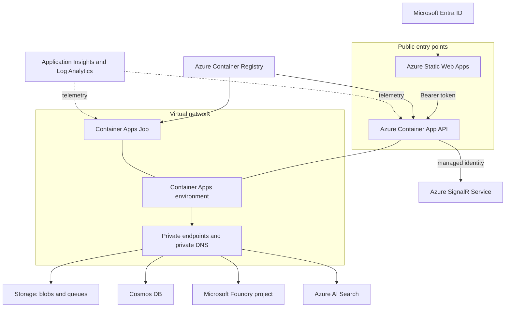
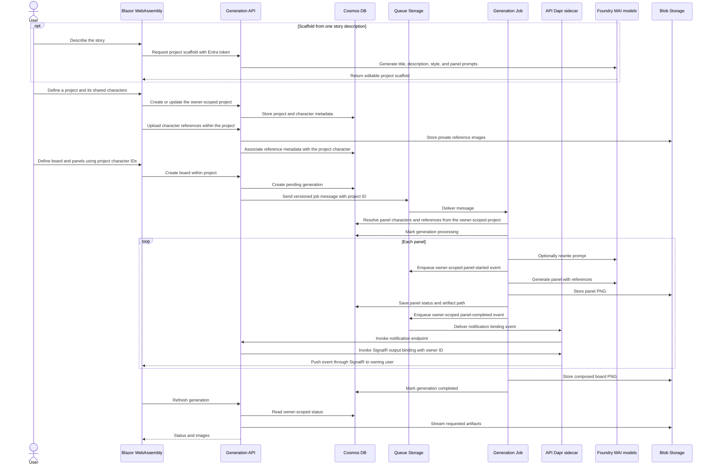

# Architecture

## Application components

| Component | Responsibility |
| --- | --- |
| Blazor WebAssembly | Authenticates users with Microsoft Entra ID, lists their projects, captures or scaffolds editable board and character inputs, uploads references, and displays generation progress. |
| .NET API | Enforces user ownership, uses MAI-Thinking to scaffold stories, validates requests, stores metadata, uploads references, submits queue messages, and streams generated artifacts. |
| Board generation job | Receives one queue message, rewrites prompts, generates panels, composes the board, and updates durable status. |
| Shared library | Defines Cosmos entities, configuration types, database context, and the versioned queue message contract. |

## Azure topology

The Container Apps environment has external ingress for the API and VNet integration for private service access. Storage, Cosmos DB, AI Search, and Foundry use private endpoints. Azure SignalR Service runs in Default mode so the API hosts the server-push-only notification hub while the service handles client connection scale-out. Negotiation requires the authenticated user's identifier claim and binds that identifier to the connection. Static Web Apps, the authenticated API, and SignalR remain public entry points. Container Registry is public in the reference deployment and also has a private endpoint.

## Generation sequence

The worker processes one message per execution. It requests regular slots at 1024 × 1024 and full-row slots at 1365 × 768, the widest 16:9-like dimensions within MAI's 1,048,576-pixel limit. It uses the MAI-native integer `width` and `height` parameters for text-to-image generation and the multipart `size` parameter for reference-guided image edits. The composer crops without distortion to the exact board slot. Technical failures are retried and removed after the configured maximum dequeue count. An image content-safety rejection is recorded on the affected panel instead: the worker continues with later panels, leaves a placeholder in the composed board, and completes the job with panel-level error details available to the UI.

The job writes panel-started and panel-completed contracts to dedicated owner-scoped notification queues. Azure Container Apps Jobs do not host managed Dapr sidecars, so the API's Dapr sidecar consumes those queues through managed-identity Storage Queue input bindings. The API invokes Dapr's Azure SignalR output binding with the owner ID in the `user` metadata field; the binding sends directly to that SignalR user without broadcasting or using groups.

The projects API creates, lists, retrieves, and updates projects through owner-partition-scoped queries. Character CRUD and reference uploads are nested under a project, and board creation accepts only panel character IDs that resolve within that project. Each board generation persists its selected layout template (Standard, Storyline, Dynamic 1, or Dynamic 2), and the worker uses that template's ordered row, column, and span slots when composing the final artifact. The Web project landing page opens a workspace where a side menu lists the project's boards, highlights the active board, and starts new boards while the existing single-board editor remains visible. Opening a board retrieves the same owner-scoped generation details and private artifacts used by the editor.

## Data ownership

The `core` Cosmos database contains the `projects`, `documents`, and `references` containers. All three use `/ownerId` as their partition key. Projects own the shared character library, while generation documents in `documents` identify their parent project with `ProjectId` and panels reference project characters by ID. Controllers derive the owner from the authenticated principal instead of accepting it from request payloads. Blob paths also include the owner and generation identifiers. Preserve these boundaries whenever adding queries, endpoints, or background messages.

The queue contract contains a schema version. Make backward compatibility explicit before changing it because deployed API and worker revisions may overlap.

## Identity and secrets

- The browser obtains an Entra access token for the generated API scope.
- Container Apps authentication validates the API audience.
- The API and worker use a user-assigned managed identity through `DefaultAzureCredential`.
- The API authenticates to Azure SignalR Service with that identity and the SignalR App Server role; no SignalR access key is injected.
- Azure service access is granted with RBAC; application code does not require storage keys, database keys, or model API keys.
- Application Insights receives its connection string from the deployment environment, not source-controlled appsettings.

## Foundry models

| Deployment | Version | SKU | Capacity |
| --- | --- | --- | ---: |
| `MAI-Thinking-1` | `2026-06-01` | `GlobalStandard` | 500 |
| `MAI-Image-2.5-Pro` | `2026-06-19` | `GlobalStandard` | 2 |

The deployments use automatic default-version upgrades and the `GuardrailNoLimits` RAI policy. Treat these as reference settings: review content safety requirements and confirm regional model availability and quota before every new environment.

## Infrastructure ownership

The authoritative deployment graph is `infra/main.bicep`; `azure.yaml` owns service packaging and lifecycle hooks. Avoid creating resources manually when they belong in the graph. Update this document whenever a component, data flow, trust boundary, or Azure dependency changes.