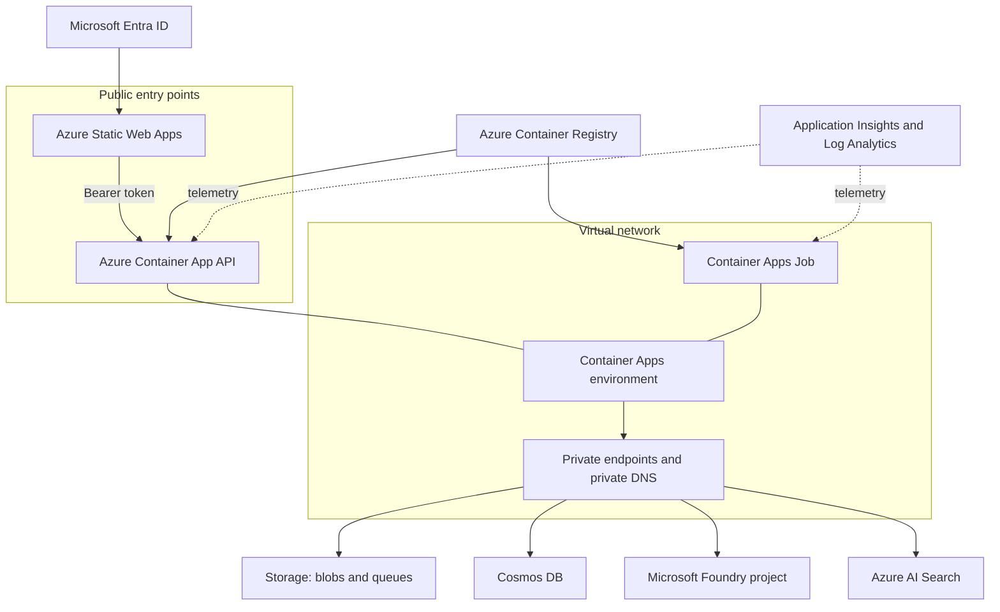
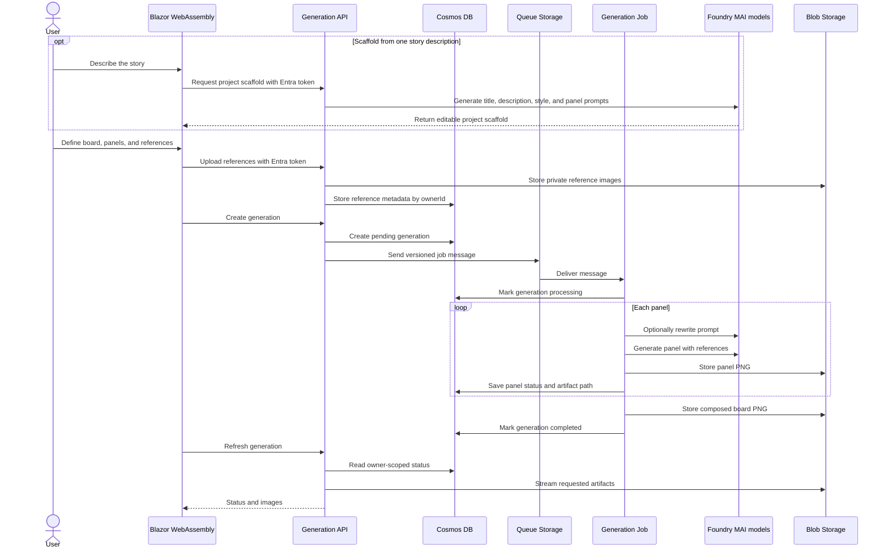

# Architecture

## Application components

| Component | Responsibility |
| --- | --- |
| Blazor WebAssembly | Authenticates users with Microsoft Entra ID, lists their projects, captures or scaffolds editable board and character inputs, uploads references, and displays generation progress. |
| .NET API | Enforces user ownership, uses MAI-Thinking to scaffold stories, validates requests, stores metadata, uploads references, submits queue messages, and streams generated artifacts. |
| Board generation job | Receives one queue message, rewrites prompts, generates panels, composes the board, and updates durable status. |
| Shared library | Defines Cosmos entities, configuration types, database context, and the versioned queue message contract. |

## Azure topology

The Container Apps environment has external ingress for the API and VNet integration for private service access. Storage, Cosmos DB, AI Search, and Foundry use private endpoints. Static Web Apps and the authenticated API remain public entry points. Container Registry is public in the reference deployment and also has a private endpoint.

## Generation sequence

The worker processes one message per execution. Technical failures are retried and removed after the configured maximum dequeue count. An image content-safety rejection is recorded on the affected panel instead: the worker continues with later panels, leaves a placeholder in the composed board, and completes the job with panel-level error details available to the UI.

The projects view reads generations through an owner-partition-scoped API query. Opening a project retrieves the same owner-scoped generation details and private artifacts used by the editor.

## Data ownership

Cosmos documents use `/ownerId` as their partition key. Controllers derive the owner from the authenticated principal instead of accepting it from request payloads. Blob paths also include the owner and generation identifiers. Preserve these boundaries whenever adding queries, endpoints, or background messages.

The queue contract contains a schema version. Make backward compatibility explicit before changing it because deployed API and worker revisions may overlap.

## Identity and secrets

- The browser obtains an Entra access token for the generated API scope.
- Container Apps authentication validates the API audience.
- The API and worker use a user-assigned managed identity through `DefaultAzureCredential`.
- Azure service access is granted with RBAC; application code does not require storage keys, database keys, or model API keys.
- Application Insights receives its connection string from the deployment environment, not source-controlled appsettings.

## Foundry models

| Deployment | Version | SKU | Capacity |
| --- | --- | --- | ---: |
| `MAI-Thinking-1` | `2026-06-01` | `GlobalStandard` | 500 |
| `MAI-Image-2.5-Pro` | `2026-06-19` | `GlobalStandard` | 2 |

The deployments use automatic default-version upgrades and the `GuardrailNoLimits` RAI policy. Treat these as reference settings: review content safety requirements and confirm regional model availability and quota before every new environment.

## Infrastructure ownership

The authoritative deployment graph is `infra/main.bicep`; `azure.yaml` owns service packaging and lifecycle hooks. Avoid creating resources manually when they belong in the graph. Update this document whenever a component, data flow, trust boundary, or Azure dependency changes.