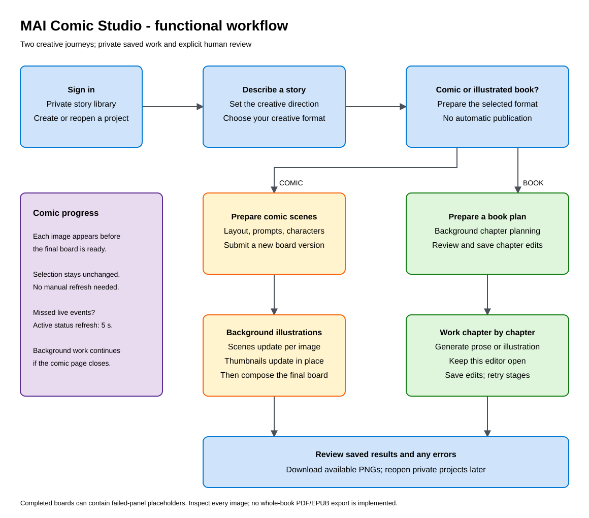
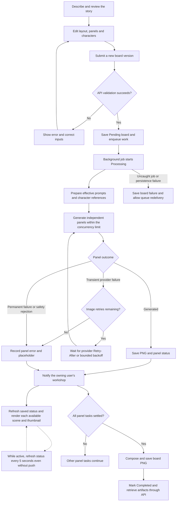
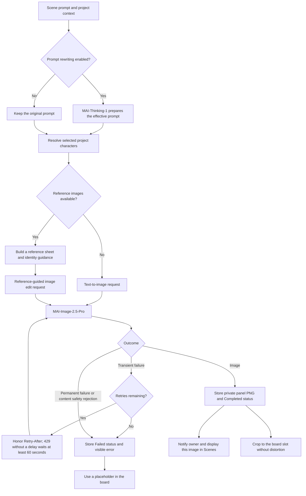
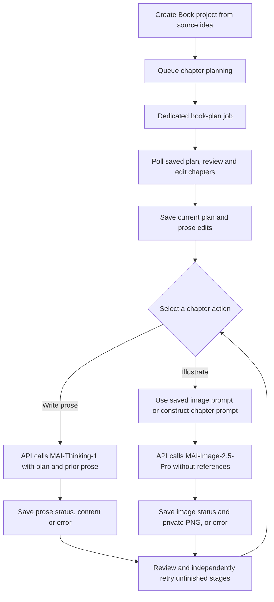

# Functional guide

## Purpose and scope

MAI Comic Studio is a training application for discovering Azure services and MAI models through comic and illustrated-book creation. It is not a production publishing tool. Use synthetic, non-sensitive stories and reference images you are authorized to process. Read the [responsible AI FAQ](responsible-ai.md) before a workshop.

The interface currently uses French labels. This guide uses English descriptions of the implemented actions.

## Navigate the workshop

| Entry point | User experience |
| --- | --- |
| `/` | Authenticated creative workshop. |
| `/projects` | Private library of saved comic and book projects. |
| `/new` | Three-step story wizard: describe, choose a format, and prepare the project. |
| `/projects/{projectId}` | Comic workspace with shared characters and board versions. |
| `/projects/{projectId}/book` | Book workspace with a chapter navigator and active chapter editor. |
| `/boards/new` | Free-form comic generation outside the guided wizard. |

Sign in with Microsoft Entra ID before using the workshop. Project metadata, reference images, generated panels, boards, and book illustrations are accessed through the authenticated API. There is no public artifact-sharing workflow.

Light/dark themes follow the browser preference initially; an explicit selection is stored locally. Library artwork indicates the project format and is not an AI-generated project cover.

## Functional overview



The [editable Excalidraw source](images/functional-workflow.excalidraw) accompanies this overview. Detailed processing flows below distinguish what continues in the background from actions that require keeping the book editor open.

## Create a comic

1. Start a new story, enter the idea, and select the comic format.
2. Let the wizard prepare a title, context, style, and scene prompts, then review and edit them.
3. Open the created project's board editor. The scaffold is an in-memory draft, not a saved board: submit generation to persist it.
4. Add named project characters and optionally upload PNG/JPEG reference images. Select the characters appearing in each scene.
5. Choose a layout and edit or reorder scene prompts. Changing the layout rebuilds the scene slots; review the editor before submitting.
6. Choose whether to rewrite prompts, then generate a new board version.
7. In **Scenes** (`1. Les scènes`), follow per-panel progress: the selected illustration and layout thumbnails update as each image becomes available, without waiting for the composed board. Changing the selected scene remains your choice.
8. Inspect the effective prompts and any panel errors. **The board** (`3. La planche`) shows the assembled PNG after composition; download available panel PNGs and the composed board PNG.

Character references guide identity but do not guarantee visual consistency. New submissions freeze the reviewed prompts, context, layout, selected character names/descriptions, reference bytes, and generation settings before queueing. Later character edits or reference replacement/deletion apply only to future submissions. Saved versions display their accepted character selections. Legacy versions without a snapshot keep historical live-metadata behavior and do not claim frozen inputs.

Accepted runs retain private copies of their references until permanent project deletion; removing a source character/reference does not erase those copies. Generation detail responses expose run/attempt IDs, deployment/template versions, settings, and reference content hashes for correlation, without private blob paths. Unknown actual model versions remain unknown. Reproducible inputs do not promise identical model output; provider upgrades and model nondeterminism still apply.

### Layouts and limits

| Layout | Panels | Arrangement |
| --- | ---: | --- |
| Standard | 6 | Three rows of two panels. |
| Storyline | 3 | One row of three panels. |
| Dynamic 1 | 5 | Two panels, one full-width panel, then two panels. |
| Dynamic 2 | 5 | One full-width panel, then two rows of two panels. |

The API supports 1 to 8 non-empty panel prompts when no explicit template is supplied; an explicit template requires its exact panel count. The workshop uses the selected template's slots. Scaffold descriptions accept 1 to 10,000 characters. Reference uploads accept PNG/JPEG files of up to 10 MiB; the HTTP request-size limit also includes multipart overhead.

### Board processing flow



Processing and output completeness are separate. The existing processing states (`Pending`, `Processing`, `Completed`, `Failed`, `Canceled`) retain their meaning: a board can be `Completed` while individual panels are `Failed`. Those slots contain placeholders; completion does not mean every scene produced an image. An isolated panel failure does not cancel other panels.

The saved result diagnosis appears in every board tab and in the board navigator. It shows completed, failed, and total panel counts, with **Complete**, **Partial**, or **No usable image** output. For example, four generated images and two failures in a six-panel board appear as **Partial**, **4 completed / 2 failed / 6 total**, even after processing finishes. A composed PNG with placeholders does not count as successful panel images. Completeness describes artifact availability, not image quality or editorial approval; editorial review is a separate future concept.

- **Queue waiting:** the API has saved `Pending`; processing has not started.
- **Provider throttling:** a panel's saved diagnosis indicates the provider request limit, including automatic retry waiting. After retry exhaustion, it suggests trying a new version later.
- **Technical failure:** a fixed, safe explanation suggests generating a new version.
- **Content-safety rejection:** the affected panel explicitly asks you to review the scene and references before creating a new version. Safety controls are not bypassed.

Available illustrations remain visible in Scenes, with an individual **Download panel** action, even when other panels or board composition fail. The assembled PNG remains downloadable when available, but may contain placeholders. Failed panels have actionable guidance in the result diagnosis and beside the selected scene. Historical records without a saved issue category use a generic technical-failure explanation rather than exposing old provider details.

Board generation continues if the page closes. Reopen the project or generation to retrieve the same durable completeness, counts, and panel diagnoses. Both started and completed progress events only request an API refresh; they cannot change the diagnosis themselves. A notification can arrive before the latest image/status is visible, so the frontend performs bounded refresh retries and explicitly renders each downloaded image. While a board is pending or processing, a five-second status refresh also recovers missed events and detects final composition. Failed artifact downloads do not change saved panel counts or prevent other images from loading; periodic refresh keeps retrying missing downloads. Normal progress does not require a manual refresh.

Uncaught job failures can trigger automatic queue redelivery. Completed panels with existing blobs are reused when an unfinished board resumes; a terminal `Completed` board is not automatically replayed even if it contains failed panels. To change a prompt or retry a failed scene as a user, edit the board and submit a new version; there is no dedicated single-panel retry endpoint.

## Export as an EPUB eBook

Use **Export as EPUB** (`Exporter en EPUB`) in either project workspace. This is an on-demand frontend action: the signed-in user downloads their eBook directly through the authenticated API, without a GitHub workflow or export automation. Finish generation and save edits first; the action is disabled while content is incomplete or there are unsaved changes. Keep the page open until the browser starts downloading `<project-title>.epub`. The filename is sanitized automatically.

- **Illustrated books:** reflowable EPUB 3.3 with a title-page cover, project title and identifier, table of contents, chapter prose in saved chapter-number order, and available PNG illustrations. The first available illustration also appears on the cover. Missing optional images do not block export, including books with no illustrations. Every chapter must have saved prose. Plain text, paragraph breaks, and line breaks are preserved; typed HTML is text, not markup.
- **Comics:** fixed-layout EPUB 3.3 with one page per completed composed board, oldest creation time first (identifier breaks ties). All completed board versions in the project are included; terminal failed/canceled attempts are skipped so a successful regeneration restores export. There is no separate curated page-order field. Each page uses the actual PNG dimensions and preserves its aspect ratio and panel layout. Any placeholders already in the composed board remain in the export.
- Both formats include a navigation document and modification timestamp. Language is `und` (undetermined) because projects do not currently store a language. No author name is inferred from the user's account.
- Private images are embedded, not linked to authenticated API URLs. The download is owner-authorized and not cached or saved as another project artifact. Once downloaded, the EPUB is an ordinary unencrypted file: keep it private or share it only deliberately.

An empty project is rejected with a message explaining what to generate. Active comic generation must finish before export, and at least one board must be completed. A missing composed PNG requires regenerating that board; a transient storage error can be retried. Missing book illustrations are simply omitted. If a board completed in another tab, reopen the workspace to refresh its state before exporting.

### Reader compatibility and validation

Fixed-layout support varies. Readers that only reflow text, including some browser EPUB extensions and older e-ink software, may ignore viewport or rendition metadata. Use a fixed-layout-capable reader for comics; text selection, font resizing, and accessible text extraction are not available inside rasterized comic boards. Book text can reflow, but illustration placement and pagination remain reader-dependent. Kindle does not natively open EPUB files; conversion/send-to-device behavior is outside this application's guarantees.

The following is a manual smoke-test checklist, **not a claim that these readers have been tested in CI**. Desktop readers are not available in the automated test environment.

| Reader | Book checks | Comic checks | Validation status |
| --- | --- | --- | --- |
| Apple Books (macOS/iOS) | Open, cover, contents, resize prose, illustrations, offline reading | Fixed-layout viewport, page order, portrait/landscape fit | Manual verification pending |
| Calibre e-book viewer | Open, contents links, chapters without images | Check fixed-layout behavior in the installed version; do not assume conversion preserves it | Manual verification pending |
| Thorium Reader | Open, contents, prose and images | Fixed-layout pages, navigation, aspect ratio | Manual verification pending |
| A fixed-layout-capable reader (Apple Books or Thorium) | — | Compare every exported page with its source PNG and test mixed dimensions | Manual verification pending |

Automated tests check ZIP/container structure, XML encoding, metadata, chapter/board order, embedded assets, owner isolation, cancellation, and both layouts. Optional local EPUBCheck 5.3.0 tests validate representative book and comic files without errors or warnings; they do not export user projects. No EPUB runtime library is added: the API uses .NET ZIP/XML APIs and reads PNG headers without decoding images.

To run the optional validator tests locally, install Java 17 or later, download and extract the [EPUBCheck 5.3.0 release](https://github.com/w3c/epubcheck/releases/tag/v5.3.0), then run from the repository root:

```bash
export EPUBCHECK_JAR=/absolute/path/to/epubcheck-5.3.0/epubcheck.jar
dotnet test tests/MaiImageGenerator.Tests/MaiImageGenerator.Main.Tests.csproj --filter FullyQualifiedName~Epub
```

Without `EPUBCHECK_JAR`, only the EPUBCheck integration cases are skipped; package/unit tests still run.

## How a panel image is produced



Regular panels request 1024 x 1024 pixels. Full-width slots request 1365 x 768 pixels. Board composition crops to fit the selected slot; preview composition and the generated source image are not identical dimensions.

## Create an illustrated book

1. Enter a source idea and select the book format in the wizard.
2. Create the project and request a plan of 1 to 30 chapters. Planning is queued and can finish while the page is closed.
3. Review chapter titles, summaries, character events, and continuity notes. Save edits explicitly.
4. Select a chapter. Generate its prose, edit it if needed, and save.
5. Enter an illustration prompt or allow the API to construct one from the chapter metadata. Generate one image for that chapter.
6. Repeat chapter by chapter, or use the generate-missing action to coordinate unfinished prose and image stages from the browser.

The prose request includes the current global plan and previously generated chapter prose. This provides context, not a guarantee of consistency. Chapter illustrations currently use text prompts only; they do not consume the comic character reference sheets or automatically illustrate the complete prose.

### Book and chapter image flow



### Save, resume, and regenerate

- **Plan generation:** durable, queued, and polled. A failed queue submission can be retried without creating another project.
- **Plan recreation:** replaces the plan fields. The worker preserves prior chapter IDs, prose, and image work by chapter position where positions still exist; a shorter plan removes later chapters from the current plan. Review preserved work for consistency with the new plan.
- **Prose/image generation:** foreground API calls. Keep the page open until the request completes; generate-missing is not a durable whole-book job.
- **Independent results:** prose and image each have their own status and error. An image failure does not invalidate saved prose, and vice versa.
- **Image regeneration:** overwrites that chapter's stable image path. Previous chapter-image versions are not retained by the application.
- **Unsaved edits:** navigation guards warn about leaving modified content. Unsaved browser edits are not a durable checkpoint.
- **Reopening:** restores saved content and stage statuses. Interrupted requests may require an explicit retry; there is no automatic whole-book process-loss recovery.

## Interpret failures and outputs

| Situation | Expected behavior or action |
| --- | --- |
| Invalid title, panel count, chapter count, or reference | Correct the input before resubmitting. |
| Board Pending for a long time | Work may be queued or waiting for a retry; use the deployment checks to inspect job executions. |
| Provider HTTP `429` | Image retries wait for the provider's requested delay; this is not necessarily a stuck generation. Exhausted retries leave an explicit failed panel. |
| Blocked comic panel | Read the panel error, revise the request appropriately, and create a new version; do not attempt to bypass safety controls. |
| Board technical failure | An isolated image failure can leave a placeholder in a completed board. Uncaught job failures record a board failure and can trigger queue retries that reuse completed panels. |
| Live notifications unavailable | Active generation status refreshes every five seconds. If progress still appears stale, check API connectivity; operators can inspect the Service Bus notification bindings. |
| Book plan failure | Retry planning. The invalid model response does not replace the saved chapters. |
| Chapter prose/image failure | Retry only the affected stage after reviewing its error. |
| Another user's project/artifact identifier | It must not grant access; the API resolves records within the authenticated owner's partition. |

There is no implemented PDF/EPUB whole-book export, collaborative editing, publication workflow, or production support commitment. The persisted status type includes `Canceled`, but there is no user-facing cancellation endpoint.

For operational diagnosis, see [deployment](deployment.md). For storage, queues, endpoints, and trust boundaries, see [architecture](architecture.md).

## Editorial and reliability baseline (E01)

### Fixed evaluation pack and current evidence

The [v1 corpus](../evaluations/comic-baseline/v1/corpus.json) contains **20 fixed synthetic briefs** covering silent storytelling, dialogue, recurring characters, spatial/prop continuity, reveals, dense text, layouts, and deliberate stylistic exceptions. E01-01 through E01-18 use the guided comic route; E01-19 and E01-20 preserve the free-form route. Two original 96 × 96 geometric robot references are embedded as lossless PNG data, with SHA-256 hashes, descriptions, and MIT authorization. They depict no real people or external characters. Initialization extracts upload-ready `pip.png` and `moss.png`; no external image service or conversion is needed.

The [fixed rubric](../evaluations/comic-baseline/v1/rubric.json) anchors **each score from 1 to 5** for story clarity, character identity, continuity, and reading order. Evaluate text fidelity/legibility as annotated findings and evidence for clarity/reading order, not as technical image-generation success. Approved exceptions are part of the brief: silhouettes, dreams, flashbacks, and colored lighting are not automatically defects.

**No live baseline has yet been measured.** The [evidence register](../evaluations/comic-baseline/v1/baseline-status.json) tracks all 20 briefs with explicitly unavailable outputs/configuration/ratings. It is not a completed evaluation report. Approved paid generation, privately retained outputs, independent human ratings, and product-owner decisions remain necessary before closing the live-evidence acceptance criteria. Unit tests, placeholder records, and LLM ratings cannot satisfy them.

Keep v1 briefs, reference bytes, rubric, and procedure fixed for comparisons. Change them only in a new corpus version, with a reason and a new baseline; do not silently repair difficult examples. Model output is nondeterministic even with identical inputs. Every run/repetition gets a new directory and run ID; never overwrite or select only the best attempt.

### Reproduce a run

Prerequisites: the repository's .NET 10/PowerShell 7 tools, explicit approval for paid live model calls, access to an authorized training deployment, and two independent human evaluators. The offline tool requires no Azure credentials, makes no model calls, and changes no application defaults, documents, queues, or contracts.

From the repository root:

```powershell
# Only creates pending records and extracts the two authorized reference PNGs.
pwsh -NoProfile -File ./scripts/comic-baseline.ps1 -RunDirectory .artifacts/comic-baseline/baseline-001 -Initialize

# After collecting evidence, validates run.json and artifact hashes, then emits JSON.
pwsh -NoProfile -File ./scripts/comic-baseline.ps1 -RunDirectory .artifacts/comic-baseline/baseline-001 > .artifacts/comic-baseline/baseline-001/summary.json

# Credential-free regression checks; these are not live quality measurements.
dotnet test tests/MaiImageGenerator.Tests/MaiImageGenerator.Main.Tests.csproj --filter FullyQualifiedName~ComicBaselineTests
```

1. **Freeze configuration.** In `run.json`, record the actual deployed `pipelineRevision` (not the evaluator checkout's automatically captured `harnessRevision`), prompt/image deployment names and actual model versions, resolved SDK/package versions, image parallelism, retry count/base delay, and safety-policy revision. Do not assume Bicep's requested model version is still deployed: automatic model upgrades can change it. Archive a sanitized configuration/package snapshot as a `configuration` artifact for each brief. `sdkVersions` may identify that snapshot. Unavailable settings remain `null`, with the reason in that snapshot; `configurationComplete` then remains false. Never export endpoints, environment dumps, tokens, connection strings, or real account identities.
2. **Use the exact inputs.** Run each brief once in ID order, in English, with prompt rewriting enabled. Use its specified template/panel count. For guided cases enter `story` verbatim as the source description, retain the first scaffold without creative edits, and archive its response. For free-form cases enter `story` as context and the exact `panelPrompts`; do not scaffold. Add each listed reference as a named character using its fixed description and PNG, select those characters on every panel, and keep project metadata unchanged until generation finishes. Record the approved submitted context/style/prompts, character selections, and layout as `approved-input` evidence. If the scaffold violates the brief, retain and annotate it rather than silently correcting it. All non-default controls must be captured in this snapshot.
3. **Retain every outcome.** Use a separate owner-scoped project/board for each brief and archive the first result, including failures, safety rejections, and partial boards. Normal worker/SDK retries belong to that attempt. Any user resubmission is a separately versioned run, not a replacement. Persist the scaffold response, final authenticated generation response, original/effective prompts, panel states/errors, all available source panel PNGs, and composed PNG. Read through the signed-in owner's API; never perform unpartitioned database export or make blob containers public.
4. **Fill the report.** The [run contract](../evaluations/comic-baseline/v1/run.schema.json) defines the initialized fields. `technicalOutcome` is `succeeded` only when every expected panel and the composed board are available and valid; `Completed` with a placeholder is `partial`, not success. Use `failed`, `safety-rejected`, or `canceled` for the corresponding unsuccessful terminal outcomes and preserve a sanitized `errorCategory`. Do not bypass safety or change the brief to obtain a passing sample. Missing/error artifacts and any capture gaps remain explicit in the annotations.
5. **Manifest artifacts.** Store files beneath the run directory, preferably `<brief-id>/…`. Add each to that brief's `artifacts` with `kind`, relative forward-slash `path`, and lowercase SHA-256, obtained with `(Get-FileHash -LiteralPath <file> -Algorithm SHA256).Hash.ToLowerInvariant()`. Never use public URLs, absolute paths, traversal, or symbolic links. The tool verifies hashes without fetching anything. Required evidence includes approved input, generation response, configuration, and, for successful boards, every panel plus the composed board. Raw human annotations, reviewer output, and telemetry have their own artifact kinds.
6. **Rate independently.** Before seeing any generated critique, two humans inspect the delivered board at the same native resolution with the brief/references/exceptions available. Each adds a `ratings` entry with a pseudonymous `evaluator`, the four integer `scores`, and per-dimension `evidence` citing panel numbers. For example, a continuity rationale might be “Panel 3: the parcel changes color after handoff.” Unassessable dimensions use `null` with an explanation, never 0 or a fabricated neutral score. Failed/unviewable samples still get annotations explaining the missing scores. Preserve both raw ratings, differences, and subsequent adjudication in an `annotations` artifact; do not replace them with a consensus-only record.
7. **Validate, freeze, sign off.** Generate the summary, review its pending IDs, configuration gaps, measurement coverage, and all 20 case reports. `pendingEvidenceBriefIds` checks basic evidence presence, not correctness or a release gate. Verify expected image counts, distinct panel contents, actual human provenance, all outcomes, and annotation quality manually. Freeze the final run directory with its manifest, summary, UTC collection window, evaluator protocol version (this repository revision), and approval record in the private evidence store. Update the evidence register only with approved, non-sensitive version identifiers and genuine status; do not commit generated outputs or ratings.

### Stage measurements and unknown values

Populate `scaffold`, `rewrite`, `image`, and `composition` separately for every report:

| Field | Collection and interpretation |
| --- | --- |
| `traces` | Copy the API's `scaffoldTraces` and each panel's `traces`, grouped by `project-scaffold`, `prompt-rewrite`, and `panel-image`. Preserve independently nullable counters and `usageSource`; do not duplicate scaffold traces from both project and board. Composition has no model trace. Keep allowlisted trace metadata, not provider payloads. |
| `requestCount` | Count actual outbound model attempts, including application retries, SDK/transport retries, and redelivery. Supply an unsampled, isolated-run telemetry artifact or another verified counting source in `measurementEvidence`. API reads, polling, notification messages, and local composition are not model requests. Trace length is only `capturedInvocationCount`, not proof of total outbound requests; if hidden retries or capture gaps cannot be resolved, leave the count `null`. |
| `retryCount` | Record verified additional attempts after an initial logical request, including redelivery effects; reference the measurement source. Do not calculate retries as requests minus one for a stage containing multiple panels. The existing image coordinator exposes retry/attempt metrics, but shared or sampled aggregates alone cannot establish one run's exact counts. |
| `wallDurationMs` | Measure elapsed stage time with a monotonic timer or correlated unsampled spans, including waits/backoff and stage work. Image-stage elapsed time spans the batch, not the sum of overlapping panel calls. Keep per-invocation `durationMs` in traces separately. Existing traces do not measure composition or complete end-to-end/queue latency; those require separate timing evidence and otherwise stay `null`. Archive submission-to-terminal/queue timings as telemetry too. |
| `state` | Distinguish `not-run`, `not-applicable`, `completed`, `failed`, `canceled`, and uncertain execution (`unknown`). Free-form scaffolding is deliberately not applicable with zero calls; composition deliberately has zero model calls. Neither implies a zero measured duration. |

Any non-null measurement requires `measurementEvidence`. Zero is valid **only for observed/provider-reported zero or a known absence of calls**, never for missing data. Model response loss may mean an unknown provider outcome and charge, not “no request.”

The reporter emits stage request/retry totals only when every brief has a known count; otherwise totals stay `null`, with known subtotals and coverage counts alongside. Reported token fields are summed independently, only from `provider-reported` values. A `reportedSubtotal` is not a complete total; `completeTotal` remains `null` unless all counted requests have matching trace counters for that field. Never infer total tokens from input plus output or treat estimates as reported usage. Preserve estimates in raw traces, clearly labeled.

Stage p50/p95 use **nearest rank** (`sorted[ceil(p × n) - 1]`) over available executed-stage wall durations, including failed attempts. Publish sample count and executed-report count; partial-coverage percentiles must not be presented as full-corpus latency. No duration samples means both percentiles are `null`. Editorial medians in the summary pool available raw human scores and report their count; they are descriptive only, not the paired-release calculation below.

Cost is explicitly `null`/`unavailable`: neither the application nor this offline tool has an itemized billing import. If authorized billing becomes available, retain its currency, time window, allocation method, exclusions, and source in separate evidence before making a cost claim. Token totals, provisioned capacity, missing counters, and zero known charges do not establish free generation or ROI.

### Blind paired comparison for later releases

This is a **proposed gate for calibration after the baseline**, not an existing result:

1. Freeze a candidate configuration and a comparison plan before inspecting results. Generate one candidate output for **every** fixed brief; retain the frozen baseline outputs rather than regenerating until a favorable pair appears. Additional repetitions must be declared in advance and all reported. Keep layout, references, rewrite setting, display resolution, and other non-treatment variables equal; document unavoidable differences and confounders.
2. An evaluation coordinator assigns opaque A/B labels independently per brief using a recorded random seed, with balanced left/right presentation. Strip pipeline names, generation timestamps, usage, filenames, and critiques from evaluator views. Keep the mapping/seed private from evaluators until their responses are locked.
3. At least two independent humans score both outputs using the same fixed rubric, then choose A, B, tie, or neither with panel-level reasons. They see the source brief and approved exceptions, but not each other's answers or LLM findings. Preserve individual preferences, scores, order assignments, null reasons, and disagreements. A third blind human adjudicates differing preferences; retain the disagreement and adjudication rather than erasing it.
4. Compute one outcome per brief from agreement or adjudication. The proposed preference target is **at least 14 of all 20 briefs (≥70%) for the candidate**. Ties, neither, unassessable pairs, and failed/missing candidate outputs are not candidate wins; never drop them from the denominator. Report technical success separately. Publish both raw-rater and adjudicated preference counts and disagreements.
5. For each dimension, take the median of the two independent ratings for each output/brief, then the median across those brief-level scores for each pipeline. Require no candidate median regression in **any** dimension; also publish median paired differences and rater disagreement counts/ranges. Use the same assessable pairs for both pipelines, disclose missing scores, and mark the gate **inconclusive** if any of the 20 pairs lacks an assessable dimension. Do not hide losses by pooling more ratings for favored cases.
6. Record the human release decision and limitations. Twenty designed examples are a formative corpus, not evidence of general superiority or statistical certainty. Expand the corpus and representation before general quality claims; retain v1 for historical comparison.

### Evaluate critiques against human actionable findings

Reviewers are experimental; this baseline adds no reviewer calls or automatic correction. Never use a model's self-rating or another LLM's score as ground truth.

- Before exposing critiques, two humans independently label observable findings against the actual artifacts and brief. In an `annotations` JSON artifact record `briefId`, stable `findingId`, panel numbers, dimension/category, description, evidence, whether actionable, and a concrete permissible correction. Preserve raw labels/disagreements and adjudicate the human reference set. Approved artistic exceptions and subjective preferences are not actionable defects.
- Run any proposed reviewer on the frozen inputs/output in independent context. Version its model, prompt, configuration, raw critique, latency, request counts, and reported usage in `reviewer-output`/`telemetry` artifacts. This optional stage is not part of the current four-stage baseline totals: report its metrics separately using the same unknown/coverage rules.
- Humans match each atomic reviewer finding to at most one adjudicated actionable human finding (same defect, location, and supported correction). A true positive requires that match; duplicate critiques of the same defect do not create more true positives. Record each reviewer `findingId`, matched human ID or null, the adjudication, and a false-positive category: `unsupported-observation`, `intentional-exception`, `subjective-preference`, `wrong-location-or-character`, `duplicate`, or `unsafe-or-nonactionable-correction`. Newly discovered valid defects require a documented human-reference revision and rescoring of all compared reviewers, not an automatic model-earned true positive.
- Report corpus-level counts and per-brief results: **precision = unique matched actionable findings / all emitted reviewer findings**; **recall = matched human actionable findings / all human actionable findings**. Report unmatched human findings (false negatives), every false-positive category, and disagreements. Zero emitted findings makes precision undefined, not 100%; zero human positives makes recall undefined. Review failure/missing output is explicit, never a successful empty critique.
- The proposed initial precision gate is **≥80%** on all 20 briefs, with recall and false-positive categories also reported. Undefined precision or incomplete evaluation cannot pass. Calibrate thresholds only after the baseline and record the decision; poor recall must remain visible even if precision passes. If the gate is missed, review stays **optional** and automatic correction stays **disabled**. Passing precision alone does not authorize either default extra calls or automatic creative changes.

### Artifact access, retention, and budget decisions

Only the synthetic fixed pack is public. Working `.artifacts/` files are ignored by Git; this is not access control. Use an encrypted, access-restricted evaluation workspace. Read application artifacts only through authenticated owner-scoped endpoints. Keep archived evidence private, owner-scoped, and versioned (for example beneath the existing owner's artifact prefix with a run ID), without introducing a public sharing path or cross-owner queries. Evaluators obtain explicit access through an authorized coordinator, not shared access tokens in reports.

For this evaluation, retain complete private run snapshots through the release decision plus **90 days**, unless the owner approves a different recorded retention period before collection. Record the custodian alias, private artifact locator, access list, retention deadline, and deletion confirmation in the private approval record. Remove working copies after verified archival. At expiry the custodian deletes exports/annotations and uses project deletion to clean up application artifacts; track linked/unclaimed scaffold sidecars separately. There is no automatic evaluation retention job, and application project deletion does not delete downloaded archives. Loss or expiry of evidence must be marked unavailable rather than replaced by invented results.

Before any extra generation/reviewer calls become a default, product owners must record a decision and acceptable **per-stage requests-per-brief and p95 wall-duration ceilings**, measured against this baseline, plus retry/deadline and overall budget limits. `ceilingApproval` stays `null` until that decision exists; its `stages` must name all four current stages with `maxRequestsPerBrief` and `maxP95DurationMs`. Proposed additional stages need their own ceilings and measurement evidence. The reporter records approval presence, **not enforcement or approval validity**. No stage is enabled by this tool, and missing billing data must never be used to infer ROI or justify extra calls.
