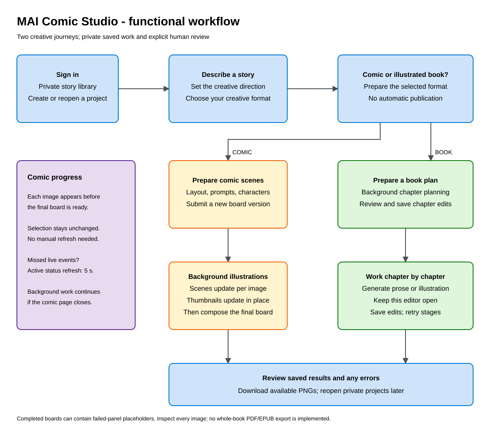
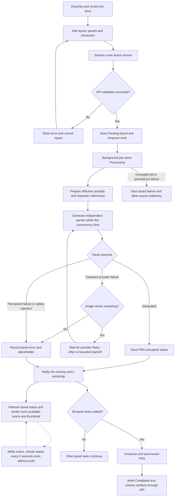
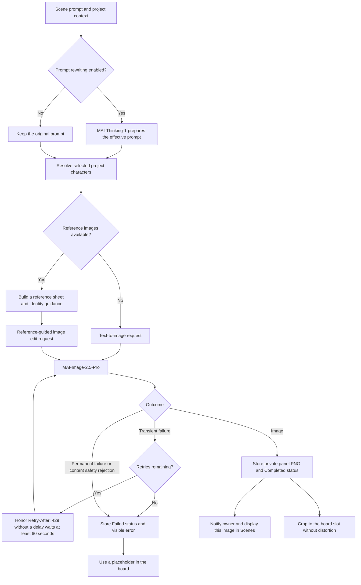
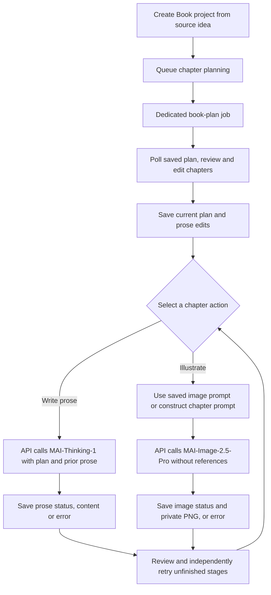

# Functional guide

## Purpose and scope

MAI Comic Studio is a training application for discovering Azure services and MAI models through comic and illustrated-book creation. It is not a production publishing tool. Use synthetic, non-sensitive stories and reference images you are authorized to process. Read the [responsible AI FAQ](responsible-ai.md) before a workshop.

The interface currently uses French labels. This guide uses English descriptions of the implemented actions.

## Navigate the workshop

| Entry point | User experience |
| --- | --- |
| `/` | Authenticated creative workshop. |
| `/projects` | Private library of saved comic and book projects. |
| `/new` | Three-step story wizard: describe, choose a format, and prepare the project. |
| `/projects/{projectId}` | Comic workspace with shared characters and board versions. |
| `/projects/{projectId}/book` | Book workspace with a chapter navigator and active chapter editor. |
| `/boards/new` | Free-form comic generation outside the guided wizard. |

Sign in with Microsoft Entra ID before using the workshop. Project metadata, reference images, generated panels, boards, and book illustrations are accessed through the authenticated API. There is no public artifact-sharing workflow.

Light/dark themes follow the browser preference initially; an explicit selection is stored locally. Library artwork indicates the project format and is not an AI-generated project cover.

## Functional overview

The [editable Excalidraw source](images/functional-workflow.excalidraw) accompanies this overview. Detailed processing flows below distinguish what continues in the background from actions that require keeping the book editor open.

## Create a comic

1. Start a new story, enter the idea, and select the comic format.
2. Let the wizard prepare a title, context, style, and scene prompts, then review and edit them.
3. Open the created project's board editor. The scaffold is an in-memory draft, not a saved board: submit generation to persist it.
4. Add named project characters and optionally upload PNG/JPEG reference images. Select the characters appearing in each scene.
5. Choose a layout and edit or reorder scene prompts. Changing the layout rebuilds the scene slots; review the editor before submitting.
6. Choose whether to rewrite prompts, then generate a new board version.
7. In **Scenes** (`1. Les scènes`), follow per-panel progress: the selected illustration and layout thumbnails update as each image becomes available, without waiting for the composed board. Changing the selected scene remains your choice.
8. Inspect the effective prompts and any panel errors. **The board** (`3. La planche`) shows the assembled PNG after composition; download available panel PNGs and the composed board PNG.

Character references guide identity but do not guarantee visual consistency. The worker uses the project's character/reference metadata when it processes the board; avoid changing that metadata during generation.

### Layouts and limits

| Layout | Panels | Arrangement |
| --- | ---: | --- |
| Standard | 6 | Three rows of two panels. |
| Storyline | 3 | One row of three panels. |
| Dynamic 1 | 5 | Two panels, one full-width panel, then two panels. |
| Dynamic 2 | 5 | One full-width panel, then two rows of two panels. |

The API supports 1 to 8 non-empty panel prompts when no explicit template is supplied; an explicit template requires its exact panel count. The workshop uses the selected template's slots. Scaffold descriptions accept 1 to 10,000 characters. Reference uploads accept PNG/JPEG files of up to 10 MiB; the HTTP request-size limit also includes multipart overhead.

### Board processing flow

The board can be `Completed` while individual panels are `Failed`, including content-safety rejections or exhausted image-provider retries. Those slots contain placeholders; completion does not mean every scene produced an image. An isolated panel failure does not cancel other panels.

Board generation continues if the page closes. Reopen the project or generation to retrieve durable status. Progress events help refresh the editor but are not the authoritative record; stored API status is. A notification can arrive before the latest image/status is visible, so the frontend performs bounded refresh retries and explicitly renders each downloaded image. While a board is pending or processing, a five-second status refresh also recovers missed events and detects final composition. Normal progress does not require a manual refresh.

Uncaught job failures can trigger automatic queue redelivery. Completed panels with existing blobs are reused when an unfinished board resumes; a terminal `Completed` board is not automatically replayed even if it contains failed panels. To change a prompt or retry a failed scene as a user, edit the board and submit a new version; there is no dedicated single-panel retry endpoint.

## How a panel image is produced

Regular panels request 1024 x 1024 pixels. Full-width slots request 1365 x 768 pixels. Board composition crops to fit the selected slot; preview composition and the generated source image are not identical dimensions.

## Create an illustrated book

1. Enter a source idea and select the book format in the wizard.
2. Create the project and request a plan of 1 to 30 chapters. Planning is queued and can finish while the page is closed.
3. Review chapter titles, summaries, character events, and continuity notes. Save edits explicitly.
4. Select a chapter. Generate its prose, edit it if needed, and save.
5. Enter an illustration prompt or allow the API to construct one from the chapter metadata. Generate one image for that chapter.
6. Repeat chapter by chapter, or use the generate-missing action to coordinate unfinished prose and image stages from the browser.

The prose request includes the current global plan and previously generated chapter prose. This provides context, not a guarantee of consistency. Chapter illustrations currently use text prompts only; they do not consume the comic character reference sheets or automatically illustrate the complete prose.

### Book and chapter image flow

### Save, resume, and regenerate

- **Plan generation:** durable, queued, and polled. A failed queue submission can be retried without creating another project.
- **Plan recreation:** replaces the plan fields. The worker preserves prior chapter IDs, prose, and image work by chapter position where positions still exist; a shorter plan removes later chapters from the current plan. Review preserved work for consistency with the new plan.
- **Prose/image generation:** foreground API calls. Keep the page open until the request completes; generate-missing is not a durable whole-book job.
- **Independent results:** prose and image each have their own status and error. An image failure does not invalidate saved prose, and vice versa.
- **Image regeneration:** overwrites that chapter's stable image path. Previous chapter-image versions are not retained by the application.
- **Unsaved edits:** navigation guards warn about leaving modified content. Unsaved browser edits are not a durable checkpoint.
- **Reopening:** restores saved content and stage statuses. Interrupted requests may require an explicit retry; there is no automatic whole-book process-loss recovery.

## Interpret failures and outputs

| Situation | Expected behavior or action |
| --- | --- |
| Invalid title, panel count, chapter count, or reference | Correct the input before resubmitting. |
| Board Pending for a long time | Work may be queued or waiting for a retry; use the deployment checks to inspect job executions. |
| Provider HTTP `429` | Image retries wait for the provider's requested delay; this is not necessarily a stuck generation. Exhausted retries leave an explicit failed panel. |
| Blocked comic panel | Read the panel error, revise the request appropriately, and create a new version; do not attempt to bypass safety controls. |
| Board technical failure | An isolated image failure can leave a placeholder in a completed board. Uncaught job failures record a board failure and can trigger queue retries that reuse completed panels. |
| Live notifications unavailable | Active generation status refreshes every five seconds. If progress still appears stale, check API connectivity; operators can inspect the Service Bus notification bindings. |
| Book plan failure | Retry planning. The invalid model response does not replace the saved chapters. |
| Chapter prose/image failure | Retry only the affected stage after reviewing its error. |
| Another user's project/artifact identifier | It must not grant access; the API resolves records within the authenticated owner's partition. |

There is no implemented PDF/EPUB whole-book export, collaborative editing, publication workflow, or production support commitment. The persisted status type includes `Canceled`, but there is no user-facing cancellation endpoint.

For operational diagnosis, see [deployment](deployment.md). For storage, queues, endpoints, and trust boundaries, see [architecture](architecture.md).
